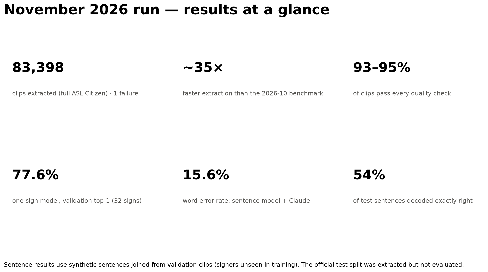
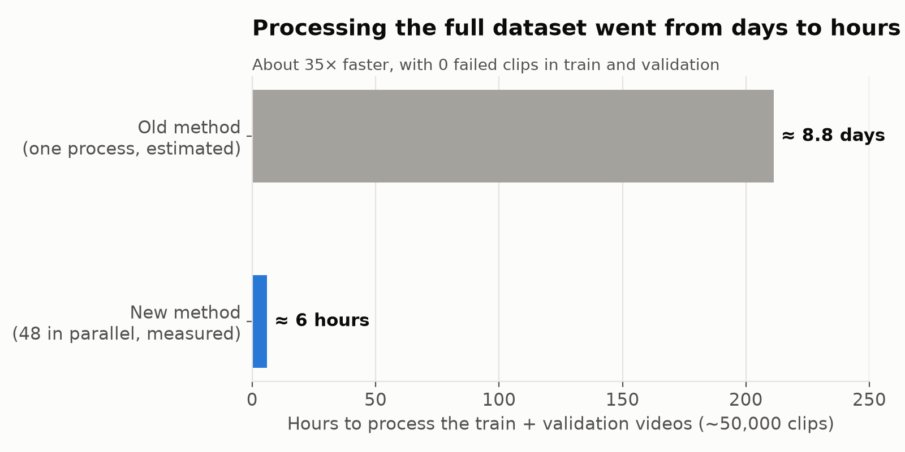
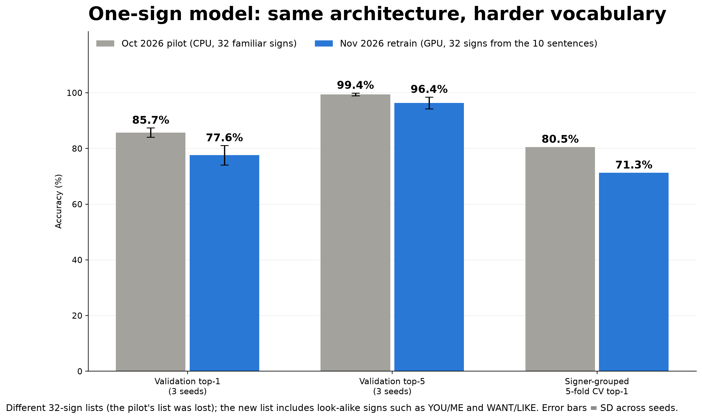
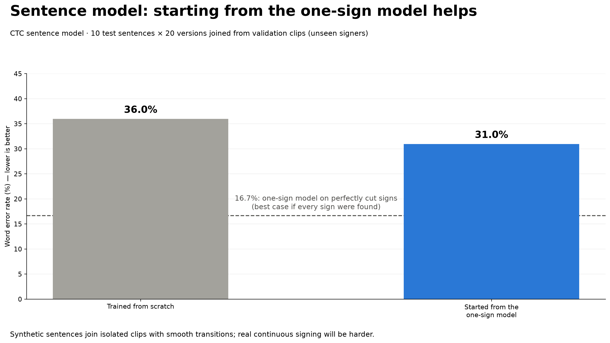
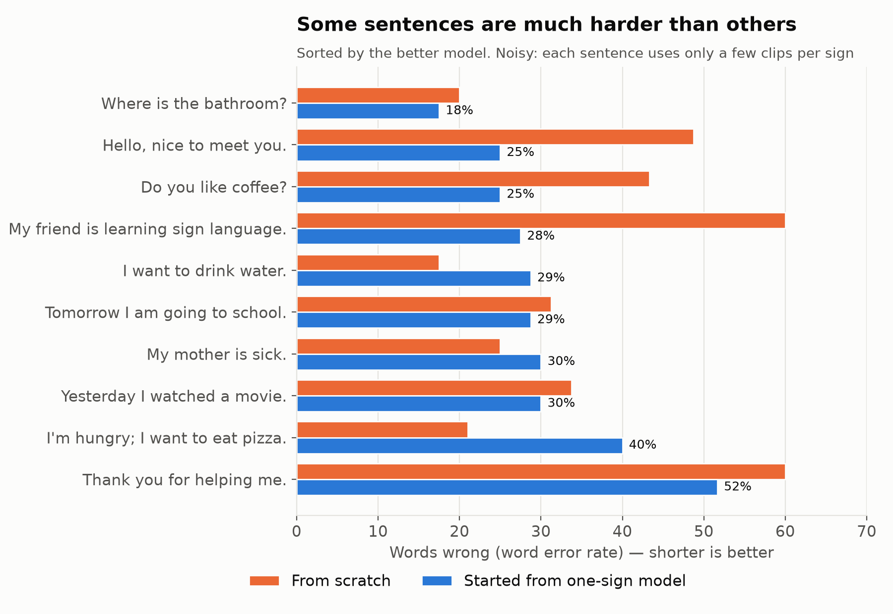
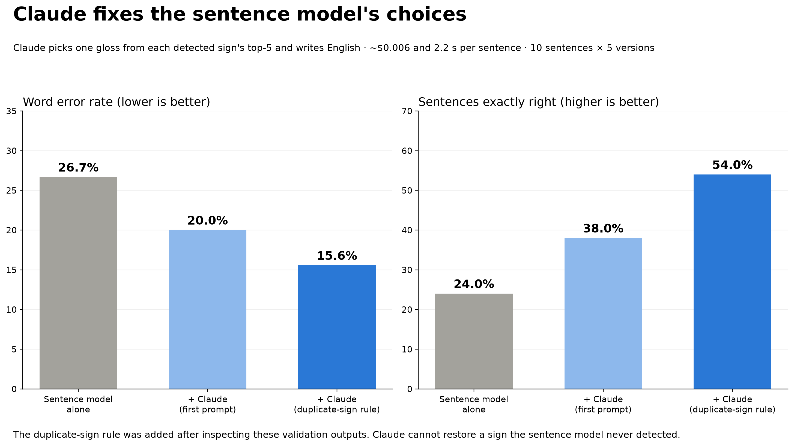
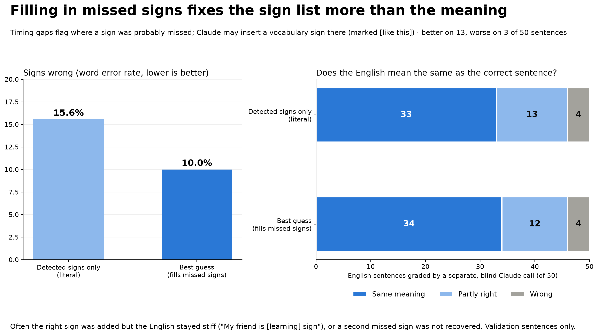

# Dev Stage 2 Results: from single signs to sentences

_ASL recognition project · results as of 13 November 2026_

## 1. The short version

- **The whole ASL Citizen dataset is processed.** 83,398 video clips were turned into body, hand and face landmarks in about 8½ hours, with 1 failure. The old method would have taken about 9 days.
- **One sign at a time works fairly well.** With 32 signs, the model's first guess is right 78% of the time, and the right sign is in its top 5 guesses 96% of the time, on people it has never seen.
- **Whole sentences work for the first time.** The new sentence model reads a sequence of signs with no one marking where each sign starts. Alone it gets about 69% of signs right.
- **Claude makes it much better.** Letting Claude choose among the model's top guesses cut sign errors from 27% to 16% and raised perfectly decoded sentences from 24% to 54%.
- **Claude can fill in some missed signs, but carefully.** Filling timing gaps cut sign errors further to 10%, but the meaning of the English barely improved yet.
- **These are early, optimistic numbers.** The test sentences were built by joining single-sign videos, and the official test set has not been used yet (on purpose).

_The November run at a glance._

## 2. What the system does

The full pipeline, which now runs end to end in the class demo:

- **Video** of a person signing.
- **MediaPipe** places dots (landmarks) on the face, hands and body in every frame. The models only ever see these dots, never the video itself.
- **Sentence model** (a neural network trained with a method called CTC) looks at the dots frame by frame and outputs the signs it detects, in order, each with its top-5 guesses.
- **Claude** (an AI language model) picks the guess that makes the most sense in context, removes a sign detected twice, may fill in a sign that was probably missed, and writes natural English.

| Term | What it means here |
|---|---|
| Sign / gloss | One ASL sign, written as an English label in capitals, e.g. WATER. ASL word order differs from English: "Where is the bathroom?" is BATHROOM WHERE. |
| Train / validation / test | Three separate groups of people. Models learn from train, are checked on validation (people they never saw), and test is locked away for one final exam. |
| Top-1 / top-5 | Is the model's first guess right? Is the right sign anywhere in its top 5 guesses? |
| Word error rate (WER) | Of the signs in a sentence, the share the model got wrong (missed, swapped or added). Lower is better. "Signs right" = 100% minus WER. |
| Exact match | The whole sentence came out exactly right. |
| Stitched sentence | A sentence built by joining single-sign clips of one person, with the pauses trimmed and smooth transitions added. We have no real sentence videos yet. |

## 3. Results

### 3.1 Processing the videos: days became hours

- The new extractor runs 48 videos at once on a Chameleon cloud computer: about 3.8 clips per second versus 0.11 before (about 35 times faster).
- Train (40,154 clips) and validation (10,304) took about 6 hours; test (32,940) about 2½ hours. Only one clip failed (no person detected in any frame).
- An automatic quality check rated 93–95% of clips "good" and 0.1% "bad" in every split.
- Re-running it gives exactly the same numbers every time, which the old method did not.
- All three splits are saved on the lab PC, so nothing is lost when the cloud lease ends.

_Processing time, old method vs new._

### 3.2 One sign at a time

The model sees one short clip and picks which of 32 signs it is. The 32 signs are the words needed for 10 everyday test sentences, plus YES, NO and PLEASE. It was trained 3 times with different random starts (seeds) on the lab PC's graphics card, about 20 seconds each.

| Measure | Old pilot (Oct 2026) | New run (Nov 2026) |
|---|---|---|
| First guess right (validation, 3 seeds) | 85.7% | 77.6% (±3.5) |
| Right sign in top 5 | 99.4% | 96.4% |
| Stricter test: 5 groups of held-out people | 80.6% | 71.3% |

**Why lower than the old pilot?** The two runs used different sets of 32 signs. The pilot's signs were picked to be easy to tell apart (that list was later lost). The new set was chosen to build sentences and includes short, look-alike signs such as ME, YOU, MY, WANT and LIKE. It is a harder list, not a worse method.

_One-sign model, old pilot vs new run._

### 3.3 Whole sentences

Each of the 10 test sentences was stitched 20 different ways, always from people the model never saw (200 sentences). Two versions of the sentence model were compared: one that started from nothing, and one that started from the one-sign model's knowledge (a "head start").

|  | From scratch | With head start | Best case* |
|---|---|---|---|
| Signs wrong (WER), test sentences | 36.0% | 31.0% | 16.7% |
| Whole sentence perfect | 20.5% | 18.5% | — |
| Signs wrong, random practice sentences | 46.6% | 35.5% | — |

_* Best case: the one-sign model shown each sign's own clip, as if the sentence had already been cut perfectly into signs. A sentence model can't realistically beat this._

- **The head start clearly helps**, so future sentence models will always start from the one-sign model.
- The two common mistakes are **saying a sign twice** (ME ME WANT …), which is easy to clean up, and **skipping a sign** ("Do you like coffee?" → YOU COFFEE), which loses meaning.
- Easiest sentence: "Where is the bathroom?" Hardest: "Thank you for helping me."

_Sentence model from scratch vs with a head start._

_Errors for each of the 10 sentences._

### 3.4 Claude chooses the signs

Claude sees only the detected signs and the model's top-5 guesses with their probabilities (never video or personal data) and may only choose from those guesses. Measured on 50 stitched sentences (10 sentences × 5 versions), using the head-start model:

|  | Signs wrong (WER) | Whole sentence perfect |
|---|---|---|
| Sentence model alone | 26.7% | 24% |
| + Claude, first instructions | 20.0% | 38% |
| + Claude, with the "duplicate sign" rule | 15.6% | 54% |

- Claude made 17 of the 50 sentences better and none worse.
- The "duplicate sign" rule tells Claude that two identical signs in a row are usually one sign detected twice. It was written after looking at these same validation sentences, so the last row is slightly optimistic.
- Cost: about half a cent and 2 seconds per sentence.

_What the Claude step adds._

### 3.5 Filling in signs the model missed

Signs normally arrive about 45 video frames apart (measured on training sentences, not the test ones). When there is a much longer silence, a sign was probably missed. Claude is told where these gaps are and which 32 signs exist, but not the list of test sentences. It returns two versions: a literal translation of the detected signs, and a best guess where filled-in words are marked like [this]. A separate Claude call, which doesn't know which version it is grading, judges whether each English sentence means the same as the correct one.

|  | Signs wrong (WER) | Same meaning | Partly right | Wrong |
|---|---|---|---|---|
| Literal (detected signs only) | 15.6% | 33 / 50 | 13 | 4 |
| Best guess (fills gaps) | 10.0% | 34 / 50 | 12 | 4 |

- Example: the model detected MY FRIEND SIGN; Claude filled in LEARN and wrote "My friend [learns] sign language."
- The sign list improved in 13 sentences and got worse in 3 (Claude guessed DRINK or YOU wrongly).
- The meaning grade barely moved: often the right sign was added but the English stayed stiff ("My friend is [learning] sign" was judged only partly right), or two signs were missing and only one came back.
- The gap detector is useful but rough: it caught 15 of 23 sentences that really had a missing sign, and falsely flagged 12 complete ones (Claude correctly added nothing to most of those).

_Filling in missed signs: sign errors vs meaning._

### 3.6 The class demo

- A web app on the lab PC (open from a laptop over SSH) runs the whole pipeline on real videos: MediaPipe live, the sentence model, then Claude. Predictions appear on screen as the sentence plays.
- It uses validation sentences only, so the test set stays sealed.
- Running MediaPipe on the lab PC gives slightly different dots than on the cloud computer, but the same accuracy within noise (31.0% vs 29.4% signs wrong), so the demo shows the real, evaluated model.
- A fast-replay option makes a sentence take about 10 seconds instead of about 50; without internet the demo falls back to the model's own guesses.

## 4. What the results mean

- **The full pipeline works.** Video to landmarks to signs to English runs end to end, and each stage was measured separately, so we know where errors come from.
- **The main weakness is missed signs.** Claude is good at choosing among guesses and removing duplicates, but it can't see the video. When the sentence model never detects a sign, Claude can only guess. Improving the sentence model is the biggest lever.
- **Starting from the one-sign model is worth it.** It cut sentence errors in every measure that mattered.
- **The numbers are optimistic, for five reasons:** (1) stitched sentences are smoother and simpler than real signing; (2) half of the sentence model's practice sentences were these same 10 sentences, though always with different people; (3) the vocabulary is 32 of 2,731 signs; (4) validation has only 6 signers and 3–5 clips per sign, so single numbers can move by several points; (5) two Claude rules were tuned on the same validation sentences they were scored on.
- **The final exam hasn't been taken.** The test split (11 signers, 32,940 clips) is processed and stored but has not been used, so a future final score will be honest.

## 5. Goals going forward

In priority order:

- **1. Full training run on the cloud GPU (lease 15–17 November).** Train bigger sentence models for longer, always with the head start, and grow the vocabulary step by step (32 → 100 → 300 signs).
- **2. Fewer missed signs.** Longer training, more varied practice sentences generated by Claude (instead of reusing the 10 test sentences), and decoding methods that are less quick to skip short signs.
- **3. Test on real sentence videos.** Joined clips are not real signing. Because no one on the team signs, these must come from an outside signer or an existing continuous-ASL dataset. This is the only way to learn the true accuracy.
- **4. Better English from Claude.** Make the best-guess English fluent (e.g. "sign language", not "sign"), and test any new instructions on fresh sentences that were not used to write them.
- **5. Freeze a model and take the final exam once** on the sealed test split, as the old pilot did.
- **6. Keep the demo current** with each improved model, still on validation sentences.

## 6. Resources used

- Extraction: one 96-thread Chameleon CPU node (CHI@UC) for about 8½ hours.
- Training: the lab PC's RTX 2070 SUPER. One-sign model about 1 minute for 3 seeds; each sentence model about 4 minutes; signer cross-validation about 9 minutes.
- Claude API: about $1.15 of a $5 test budget for all measurements and demo runs so far.

## 7. Files in this folder

| File | What it is |
|---|---|
| Results Explained - Dev Stage 2.docx / .md | This document |
| RESULTS_full_numbers.md | Every measured number, generated automatically from the run outputs |
| 08–12_*.png | Presentation figures (same style as the Stage 1 deck) |
| chart_1–4_*.png | Simpler charts used in the plain-English explainer |
| data/ | The result files the numbers come from (JSON), the 10 sentences and the 32 signs |
| contact_sheet*.png | Earlier Stage 1 images, left as they were |
